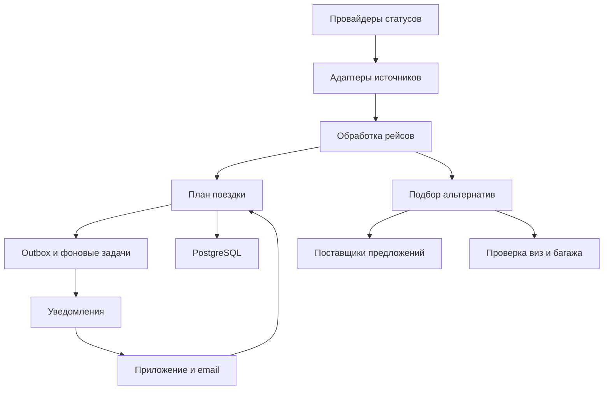
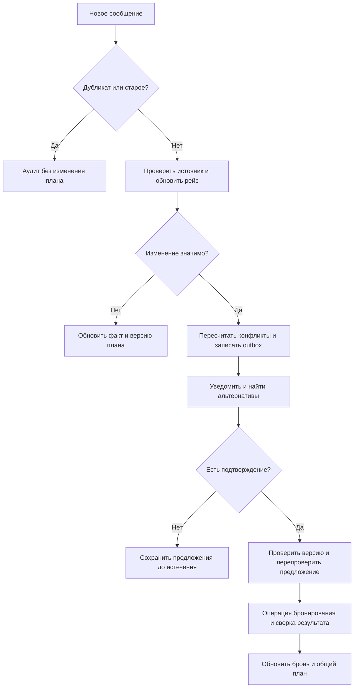
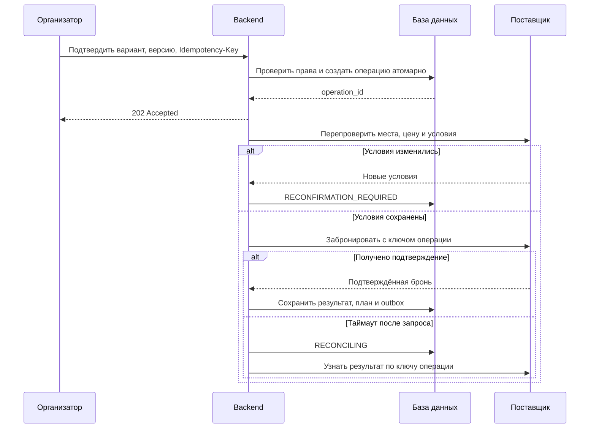

# 3. Архитектура и обработка изменений

## Компоненты

Для MVP выбран модульный backend с PostgreSQL и отдельными фоновыми обработчиками. Модули ниже обозначают логические границы; развёртывать каждый отдельным микросервисом не требуется. Outbox обеспечивает надёжную передачу задач после транзакции. Очередь может быть реализована поверх таблицы задач; конкретный брокер выбирается по нагрузке.

## Получение и свежесть данных

Предпочтителен webhook с проверкой подписи и защитой от повторного воспроизведения. Polling дополняет webhook и восстанавливает пропущенные обновления. Проектный интервал: раз в 30 минут за 24–72 часа до вылета, раз в 5 минут за 24 часа и до завершения сегмента; вне этого окна раз в сутки. Частота адаптируется к квотам, ответу Retry-After и качеству источника.

Рассылки поступают только через согласованный канал. Разбор письма не запускает покупку и не выполняет содержащиеся в письме команды; распознанный статус с низкой уверенностью сверяется через API. Сырые письма могут содержать личные данные, поэтому их хранение минимизируется, а сроки удаления задаются отдельно.

Для одного источника сначала используется монотонная версия провайдера, если она есть; иначе source_updated_at. Дубликат определяется по (provider, provider_event_id). received_at отражает задержку доставки и не используется как признак новизны факта. При одинаковой версии с различающимся содержимым событие уходит на сверку.

Версии разных провайдеров не сравниваются между собой. В MVP один источник назначен основным для конкретного экземпляра рейса. Свежие противоречащие данные дополнительного источника помечаются как конфликт, инициируется запрос к основному. Смена основного источника проводится явной процедурой с аудитом. Если время источника отсутствует, достоверный порядок установить нельзя: требуется свежий снимок, а не слепое применение события.

Статус может быть исправлен перевозчиком, включая отмену ошибочной отмены. Поэтому используется порядок версий источника, а не запрет обратных переходов. Недоступность источника не превращает рейс в отменённый: отображаются last_checked_at, source_updated_at и отметка «данные требуют обновления».

## Процесс

## Подтверждение замены

Операция: PENDING → RECHECKING → BOOKING → SUCCEEDED. Возможны RECONFIRMATION_REQUIRED, FAILED и RECONCILING. Последнее состояние означает неизвестный результат, а не отказ покупки. При расхождении версии после внешнего успеха подтверждённая бронь сохраняется отдельно и план согласуется без затирания параллельных правок. До разрешения операция блокирует вторую замену этой брони.

Нельзя атомарно закоммитить БД и API поставщика. Выбран процесс с сохранением намерения, ключом идемпотентности у поставщика и последующей сверкой. Если поставщик не поддерживает ни ключ, ни поиск результата, автоматические повторы покупки запрещены; операция передаётся поддержке. Возврат исходного билета — отдельное подтверждаемое действие, учитывающее тариф и риск двойных затрат.

## Уведомления и офлайн

В одной транзакции сохраняются новый план, конфликт и outbox. Обработчики читают outbox с повторами. Ключ уведомления: (change_id, recipient_id, channel). Ключ события хранится не меньше максимального согласованного окна повторов провайдера; бизнес-идемпотентность операции сохраняется на весь период её возможной сверки.

Центр уведомлений — устойчивый источник истории. Состояния по каналу: QUEUED, SENT, FAILED; отдельное read_at означает прочтение в приложении. Push содержит минимум сведений, подробности доступны после авторизации. При отсутствии подтверждения доставки push в течение 2 минут для критического изменения отправляется email, если канал разрешён. Отсутствие открытия приложения само по себе не доказывает недоставку push. Неоднозначная внешняя доставка может привести к повторному сообщению, но не к повторной операции бронирования.

При восстановлении сети клиент загружает полный актуальный план с версией и свои непрочитанные уведомления. Локальное подтверждение устаревшего варианта не применяется автоматически: сервер отвечает конфликтом. На офлайн-экране указано время последней синхронизации.

## Отказы и наблюдаемость

Вызовы ограничены таймаутами; повторяются безопасные запросы с exponential backoff и jitter. После серии ошибок circuit breaker временно прекращает вызовы. Безнадёжные задачи попадают в очередь ручного разбора. Операции изменения брони повторяются только с идемпотентностью/сверкой.

Наблюдаются задержка данных источника, возраст последнего успешного опроса, длина очереди, ошибки провайдеров, время обработки, доля RECONCILING и ошибки каналов. correlation_id связывает событие, план, операцию и уведомление без паспортных данных. Недоступность поставщика поиска не блокирует просмотр существующего плана и предупреждение об отмене.
