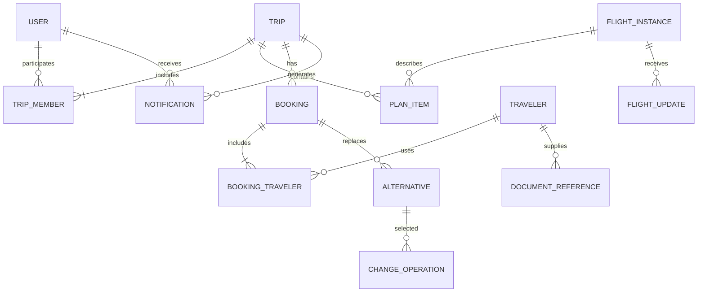

# 4. Логическая модель данных

## Сущности и ограничения

| Сущность | Основные поля и правила |
|---|---|
| USER | id, контакты, согласия на каналы; учётная запись пользователя |
| TRAVELER | id, trip_id, необходимые ограничения, контакт ответственного; может быть ребёнком без аккаунта |
| TRIP | id, organizer_id, version, starts_at, ends_at, status; version растёт при каждом изменении плана |
| TRIP_MEMBER | trip_id, user_id, role; уникальная пара; членство определяет доступ к плану |
| FLIGHT_INSTANCE | id, carrier, number, departure_service_date, origin, destination, scheduled/estimated/actual departure и arrival, зоны аэропортов, status, authoritative_provider, source_version, source_updated_at, last_checked_at |
| FLIGHT_UPDATE | id, flight_id, provider, provider_event_id, source_version, source_updated_at, received_at, applied, reason; уникальный provider + provider_event_id |
| PLAN_ITEM | id, trip_id, type, flight_id nullable, booking_id nullable, starts_at, ends_at, time_zone, conflict_reason, version; типы FLIGHT, TRANSFER, HOTEL, ACTIVITY |
| BOOKING | id, trip_id, provider_reference, status, replaced_booking_id nullable; факт покупки отдельно от планового элемента |
| BOOKING_TRAVELER | booking_id, traveler_id; уникальная пара; состав пассажиров, для которого ищут замену |
| ALTERNATIVE | id, booking_id, base_plan_version, expires_at, price_amount, currency, baggage_summary, visa_check, available_seats, segments; снимок предложения |
| CHANGE_OPERATION | id, trip_id, booking_id, alternative_id, actor_id, idempotency_key, request_hash, base_plan_version, status, result_booking_id, failure_code; уникальный ключ в пределах пользователя и операции API |
| NOTIFICATION | id, trip_id, recipient_id, change_id, created_at, read_at; канальные попытки доставки хранятся отдельно |
| DOCUMENT_REFERENCE | id, traveler_id, vault_reference, purpose, delete_after, deleted_at; содержит ссылку, без номера паспорта |

Для рейса используется ключ перевозчик + номер + дата обслуживания у аэропорта отправления + аэропорты. Если провайдер выдаёт стабильный ID экземпляра рейса, хранится также отображение его ID во внутренний ID. Дата обслуживания не пересчитывается по UTC при переносе за полночь.

Внутри PostgreSQL абсолютные моменты — timestamptz, календарные даты — date. IANA-зона хранится отдельно: timestamptz сам по себе не сохраняет исходное имя зоны. Денежные значения — decimal с валютой, без float; суммы разных валют не складываются без явного курса и времени конвертации.

Вспомогательные таблицы: OUTBOX (id, event_type, aggregate_id, payload, created_at, published_at), DELIVERY_ATTEMPT, IDEMPOTENCY_RECORD и AUDIT_LOG. У outbox и бизнес-изменения одна транзакция. У активной операции на booking_id — ограничение единственности для состояний PENDING, RECHECKING, BOOKING, RECONCILING. Терминальные результаты сохраняются для ответов на повторы.

## Защита и удаление документов

Номер паспорта, сканы и иные документы хранятся только в отдельном хранилище с шифрованием и управлением ключами. Backend получает короткоживущую ссылку для необходимой операции бронирования. В модель рекомендаций передаются только минимальные атрибуты: например, гражданство и результат проверки транзита; их необходимость и сроки хранения также оцениваются отдельно.

Для каждого документа фиксируются цель и delete_after. Срок — минимально необходимый для согласованной цели; завершение или отмена поездки запускает пересмотр и удаление, если больше нет обоснованной потребности. Универсальный срок вроде «ещё 30 дней на всякий случай» не устанавливается. Конкретные сроки и правовые исключения должны быть согласованы до запуска.

Планировщик удаляет объект, производные копии и кэш; процедура повторяема. Метаданные об удалении не содержат паспортных значений. Очистка активного хранилища должна происходить не позднее согласованного delete_after; частота задания и запас времени под повторы выбираются под этот предел. Неуспешное удаление вызывает оповещение ответственного.

Для резервных копий заранее выбирается способ выполнения срока: исключение краткоживущего хранилища из общих бэкапов либо отдельные ключи шифрования с уничтожением в срок. При восстановлении применяется реестр удалений до выдачи доступа. Данные документов запрещены в payload событий, журналах и аналитике. Копии у внешних поставщиков регулируются отдельными договорённостями и не считаются автоматически удалёнными нашим сервисом.
